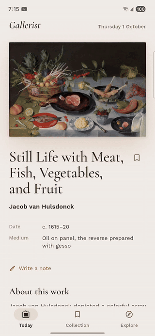
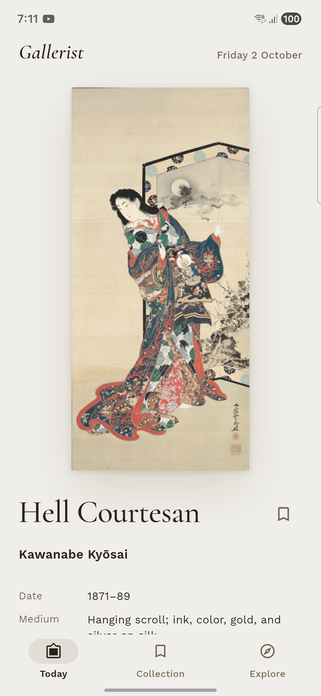
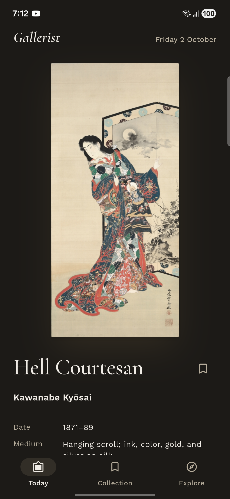
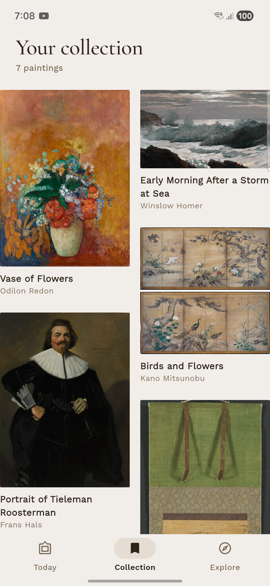
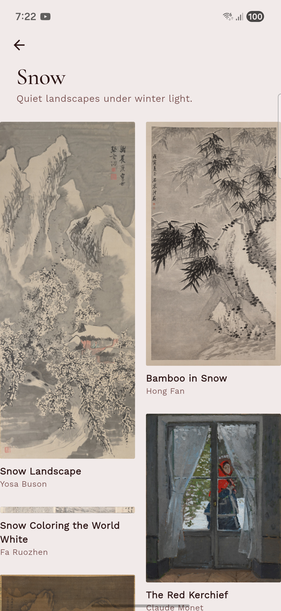
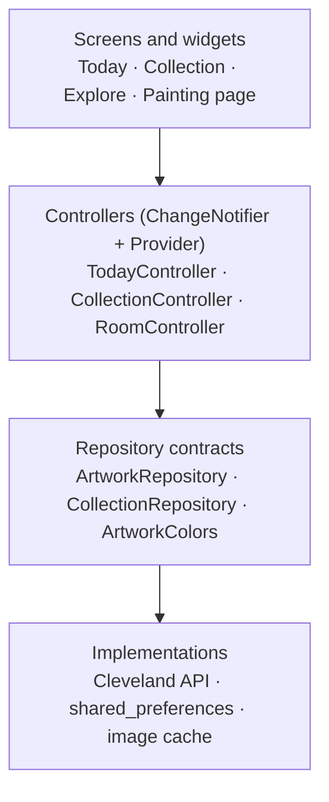

# Gallerist

**One painting a day, in a room that takes on its colors.**

Gallerist is a calm, offline-first Flutter app that shows a different public-domain masterpiece from the Cleveland Museum of Art each day. The whole interface re-tints itself to match the painting you're looking at.

<p align="center">
  
</p>

<table>
  <tr>
    <td></td>
    <td></td>
    <td></td>
    <td></td>
  </tr>
</table>W

## Features

- **A painting a day.** The same painting for everyone on a given day, picked from the museum's highlights, with no server of my own.
- **Rooms that match the art.** Colors are taken from each painting and toned down into a calm wall, text and accent. Text contrast is checked to meet WCAG 4.5:1 for every hue, in light and dark mode.
- **Swipe back through 30 days.** The room fades to each painting's colors as you arrive.
- **Your collection.** Save paintings and write notes about them. Press and hold to remove, with Undo.
- **Explore by theme.** Rooms like *Snow*, *Water* and *The Sea*, each opening into its own salon-style grid.
- **Look closer.** Tap any painting to fly it into a full-screen viewer with pinch-to-zoom.
- **Works offline.** Painting details, images and colors are all cached on the device.
- **Light and dark mode**, and respect for the system's reduce-motion setting.

## How it's built



- **Layers:** models, data (API and repositories), state (controllers) and UI are kept separate. Screens never talk to the network directly.
- **Contracts:** repositories and the color finder sit behind abstract classes, so the museum can be swapped and the controllers can be tested with fakes.
- **Caching:** the list of paintings is cached on the device for 30 days, with a fallback to older data when offline. Images are cached as files.
- **Theming:** a custom `ThemeExtension` (`ArtPalette`) holds the painting-derived colors, with a `lerp` so every theme change fades smoothly.

**Packages:** `provider`, `http`, `shared_preferences`, `cached_network_image`, `google_fonts`, `flutter_animate`, `flutter_staggered_grid_view`, `intl`.

## Engineering notes

A few problems I ran into, and how I solved them:

- **Choosing the data source by testing, not guessing.** The app started on the Art Institute of Chicago API, but its image server returned `403 Forbidden` to the app. I isolated the problem in a small Dart script (three different `User-Agent` headers, all blocked), then tested the Met and Cleveland the same way before switching to Cleveland. Because the app was built on a repository contract, the switch didn't touch the controllers or screens.
- **A race condition when swiping.** Each swipe starts reading the new painting's colors in the background. Swiping quickly could let an older result finish last and paint the room the wrong color. The controller now checks that the day is still selected before applying a result.
- **A bug that only appeared after a restart.** A save-and-reload unit test failed because `toJson` nested two fields at the wrong level. In the app, paintings looked right when fresh from the network and wrong when read from the cache. The test caught it in a second, and printing the actual data revealed a second bug (a wrong JSON key) that no test was checking yet.
- **Readable colors for every painting.** Fixed lightness values made the accent nearly invisible on yellow paintings, because yellow looks much brighter than blue at the same HSL lightness. Colors are now adjusted until they reach a 4.5:1 contrast ratio, and a test checks 288 hue and saturation combinations in both modes.

## Running it

```bash
flutter pub get
flutter run
```

The app targets Android first. It also runs on Linux desktop. It doesn't run in a web browser, because the museum's API doesn't allow cross-origin requests.

## Tests

```bash
flutter test
```

Unit tests cover the model's JSON parsing, the daily pick, every controller (using fake repositories), the real storage layer, and color contrast.

## Credits

- Artwork images and data: [The Cleveland Museum of Art Open Access](https://openaccess-api.clevelandart.org/), released under CC0.
- Fonts: [Cormorant Garamond](https://fonts.google.com/specimen/Cormorant+Garamond) and [Work Sans](https://fonts.google.com/specimen/Work+Sans), under the SIL Open Font License.

Built by [Prajwal Chaudhary](https://github.com/prajwalccc13).